# shots

Frame a web page or an image in a drawn macOS Safari window or an iPhone, on a
coloured canvas sized for X, Instagram and Open Graph. It also draws Telegram:
a Mini App, or a chat rendered from a few lines of JSON. A CLI for you and an
MCP server for your agent, so a framed mockup is one command or one tool call.

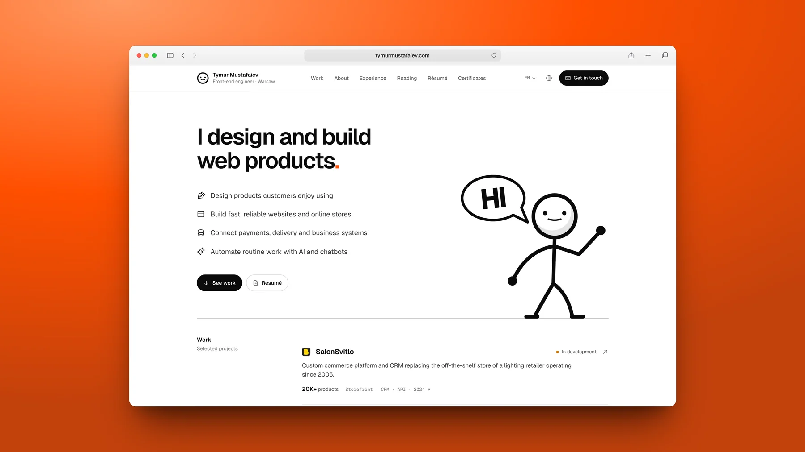

|           Two phones, fanned           |                Desktop with phone                |
| :------------------------------------: | :----------------------------------------------: |
| 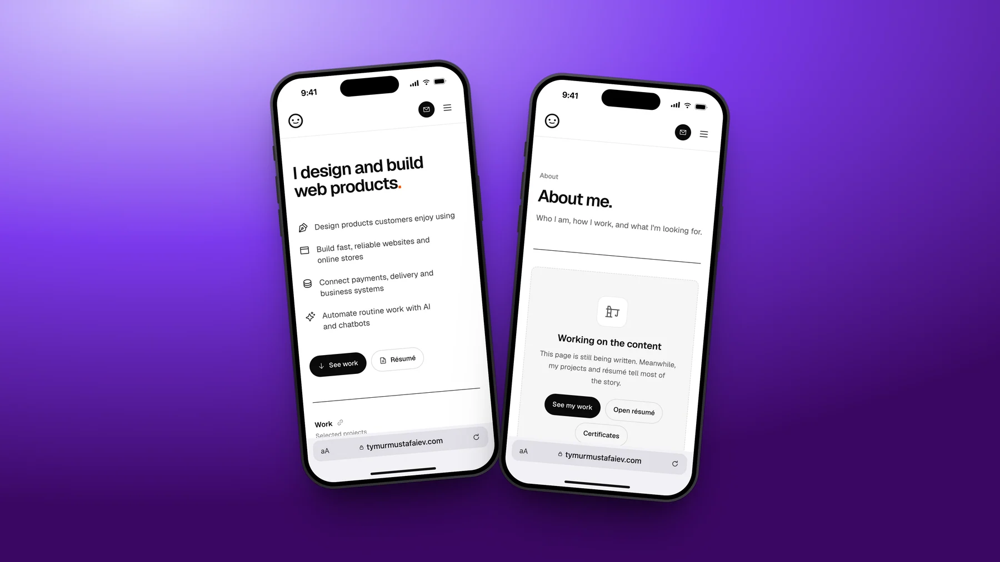 | 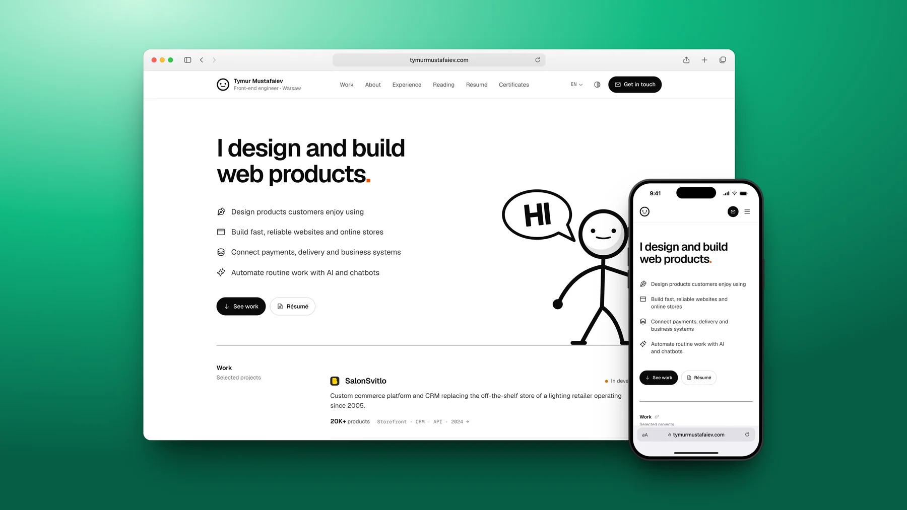 |

|            Instagram portrait, 4:5            |  Instagram square, 1:1, tilted   |
| :-------------------------------------------: | :------------------------------: |
| 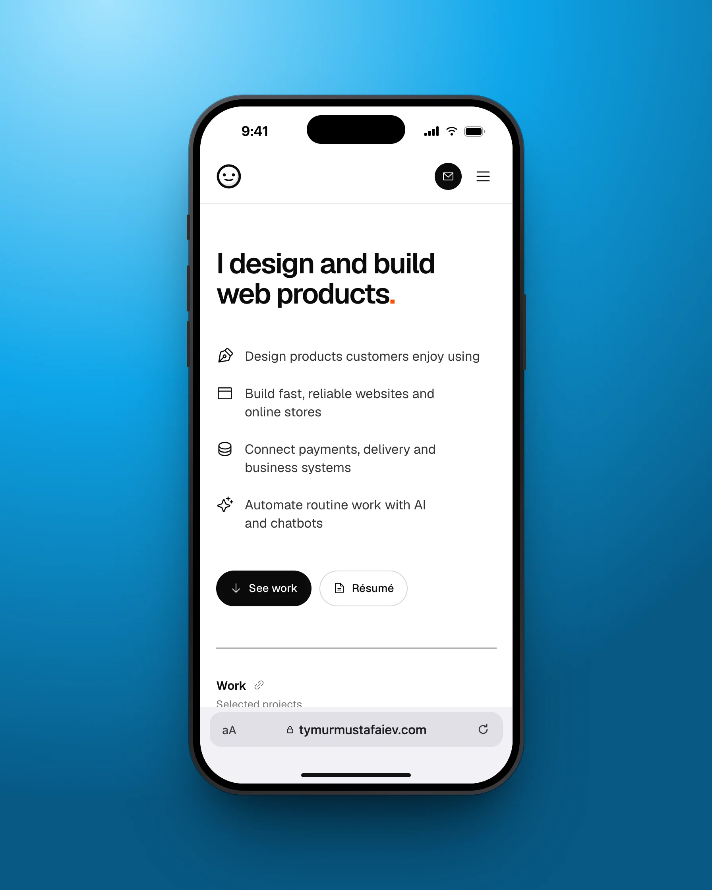 | 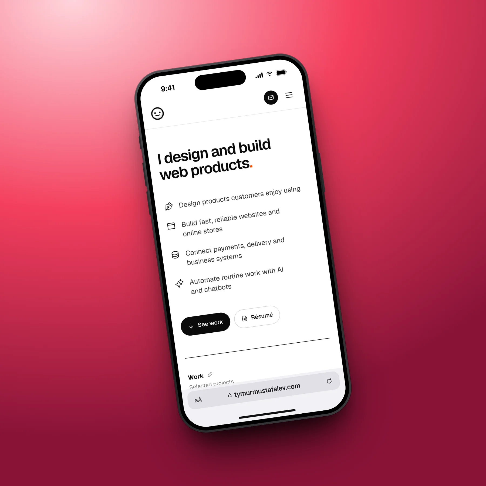 |

|   Dark page, dark Safari   |          Your own colours, no toolbar          |
| :------------------------: | :--------------------------------------------: |
| 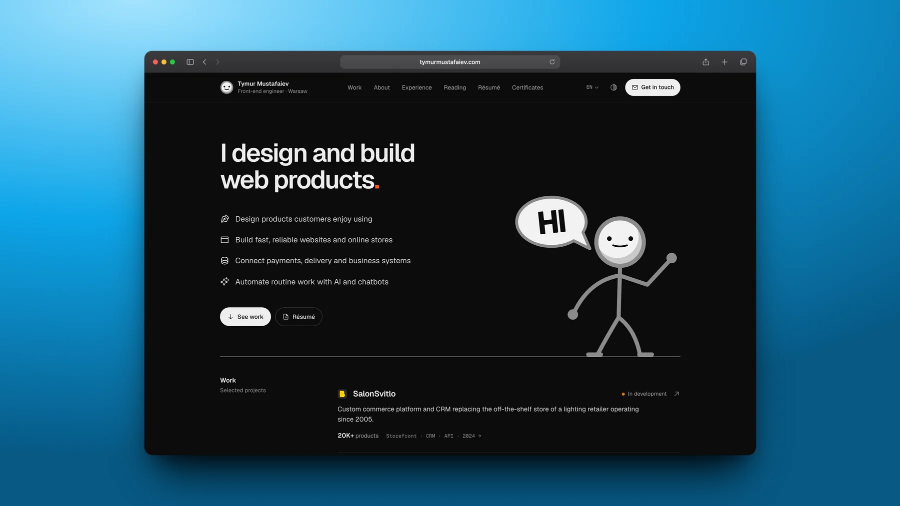 | 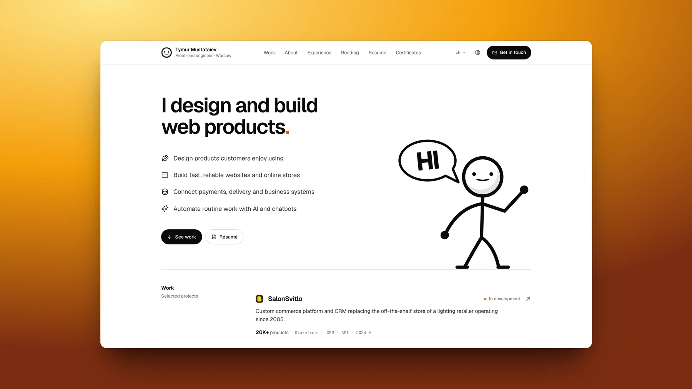 |

|              Telegram Mini App               |         Telegram chat, from JSON          |
| :------------------------------------------: | :---------------------------------------: |
| 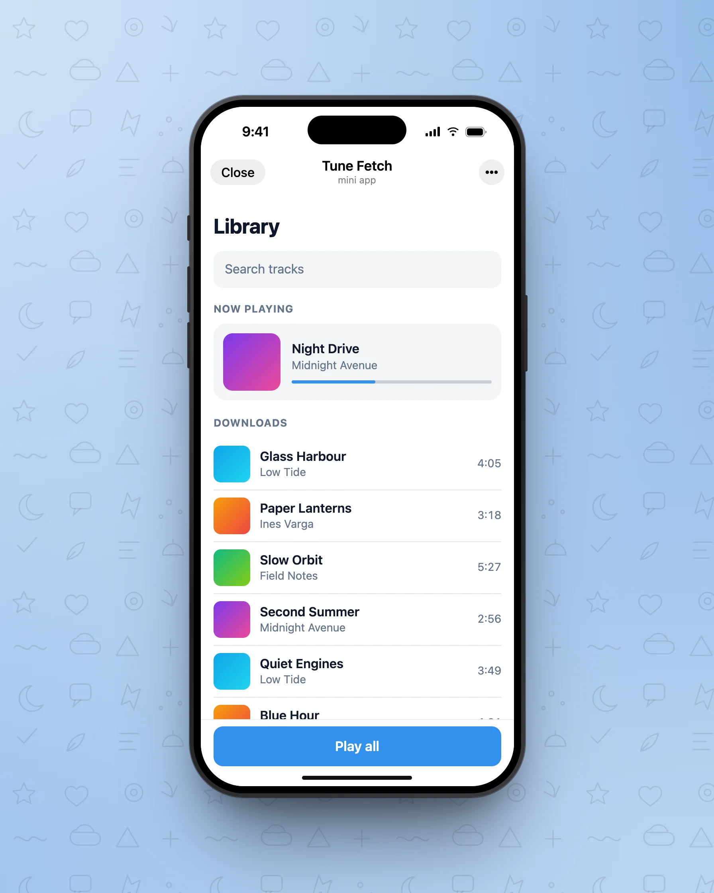 | 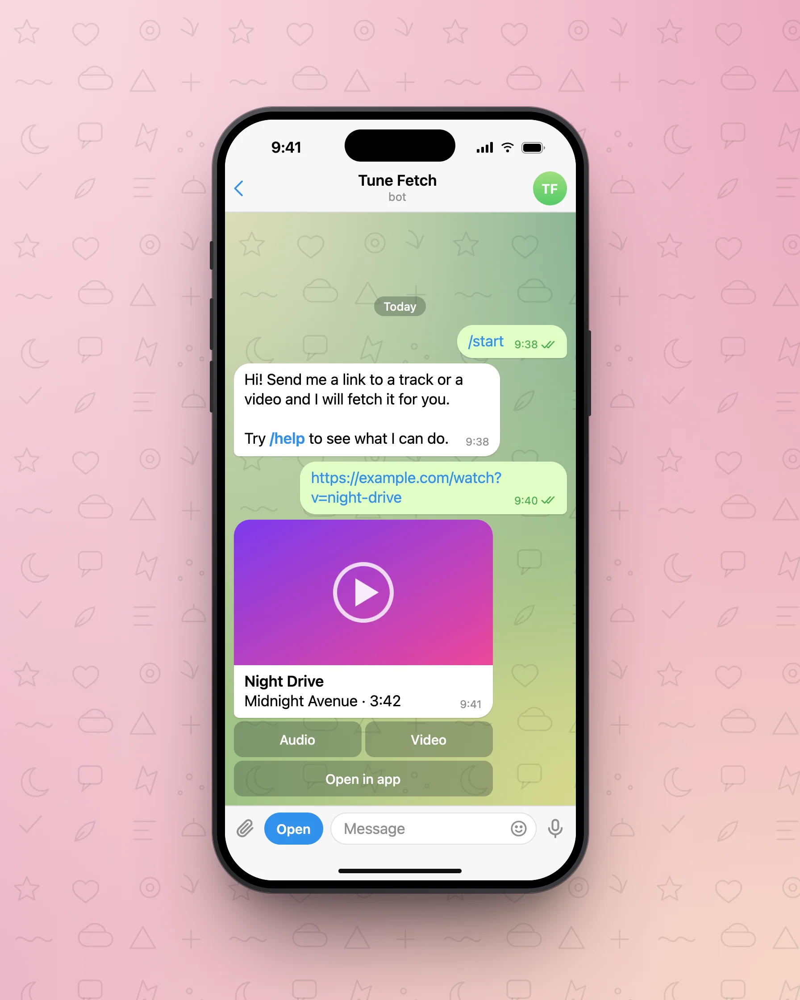 |

|        Desktop chat with the Mini App window         |      Chat and Mini App, fanned      |
| :--------------------------------------------------: | :---------------------------------: |
| 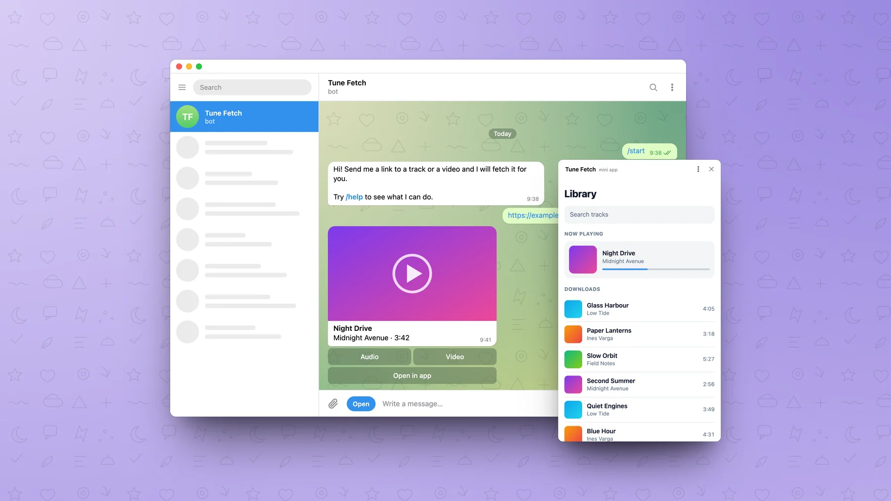 | 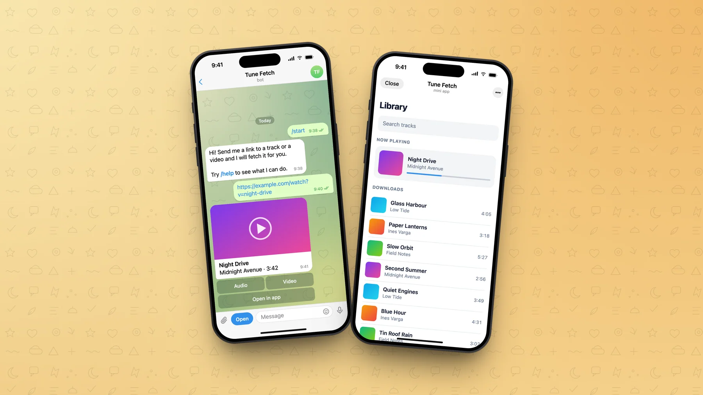 |

More in [`samples/`](samples): every preset on both devices, and a transparent
phone.

## Install

Needs Node 20+ and an installed Google Chrome (it is driven through
`playwright-core`; no browser is downloaded).

```bash
git clone https://github.com/exx0dusss/shots ~/GitHub/exx0dusss/shots
cd ~/GitHub/exx0dusss/shots
pnpm install
pnpm link --global   # puts `shot` and `shots-mcp` on your PATH
```

Without linking, run `node ~/GitHub/exx0dusss/shots/bin/shot.js` instead of
`shot`.

## CLI

```bash
# a page in a Safari window, for an X post
shot https://example.com --preset x --out x.png

# the same page on an iPhone, for Instagram
shot https://example.com --device phone --preset instagram-portrait --canvas ocean --out ig.webp

# your local dev server, cookie banner accepted, scrolled to a section
shot localhost:3000/pricing --accept "Accept" --scroll 600 --preset x --out pricing.png

# frame a screenshot you already have
shot raw.png --bar example.com --preset instagram-square --out square.png

# two phones, fanned apart
shot localhost:3000 localhost:3000/cart --device phone --tilt 5 --preset x --out pair.png

# a window with a phone in front
shot desktop.png phone.png --device desktop,phone --preset x --canvas mint --out both.png

# Open Graph image, exactly 1200×630
shot https://example.com --preset og --canvas dark --out og.png

# presets and canvases, including the ones in your config
shot list
```

A source is a URL (captured) or an image file (framed as it is). `localhost:3000`
and `example.com` work without the scheme.

### Options

| Option                | What it does                                                                                                                                                                 |
| --------------------- | ---------------------------------------------------------------------------------------------------------------------------------------------------------------------------- |
| `--out <file>`        | Output image; the extension picks the format: `.png`, `.webp`, `.jpg`. Required                                                                                              |
| `--device <kind>`     | `desktop` (default) or `phone`. With two sources: `phone` for both, or `desktop,phone`                                                                                       |
| `--preset <name>`     | `x`, `instagram-portrait`, `instagram-square`, `og`                                                                                                                          |
| `--aspect <w:h>`      | A free canvas ratio instead of a preset, e.g. `3:2`. With neither, the canvas hugs the frame                                                                                 |
| `--canvas <name>`     | Background, see [Canvases](#canvases). Default `accent`                                                                                                                      |
| `--pad <px>`          | Canvas padding around the frame, in CSS px. Default 120                                                                                                                      |
| `--shadow <strength>` | `none`, `soft`, `medium` (default), `strong`, or a number 0–2                                                                                                                |
| `--tilt <deg>`        | Turns the frame, -45 to 45. Two phones fan apart instead                                                                                                                     |
| `--bar <text>`        | Address shown in Safari. Default: the URL's host. `none` draws the window or phone with no toolbar                                                                           |
| `--theme <t>`         | Safari's colour: `auto` (dark on a dark page), `light`, `dark`                                                                                                               |
| `--frame <kind>`      | What is drawn in the device: `safari` (default), `telegram-app`, `telegram-chat`; see [Telegram](#telegram). `none` writes the bare capture (no device, no canvas) and stops |
| `--width <px>`        | Output width. Default is native resolution; `og` defaults to 1200. `native` forces native                                                                                    |
| `--scale <n>`         | Device pixel ratio, 1–3. Default 2                                                                                                                                           |
| `--quality <n>`       | WebP and JPEG quality. Default 90                                                                                                                                            |
| `--viewport <WxH>`    | Desktop page size in CSS px. Default `1440x900`                                                                                                                              |
| `--scheme <s>`        | Emulate `prefers-color-scheme`: `light` or `dark`                                                                                                                            |
| `--accept <text>`     | Click a button with this text before capturing (a cookie banner)                                                                                                             |
| `--scroll <px>`       | Scroll down before capturing                                                                                                                                                 |
| `--wait <ms>`         | Wait longer before capturing (animations, late content)                                                                                                                      |
| `--hide <selectors>`  | CSS selectors to hide, comma separated. Common dev overlays are always hidden                                                                                                |
| `--batch <dir>`       | Frame every image under `<dir>` with the same options, writing the same tree under `--out`                                                                                   |
| `--config <file>`     | Config file. Default: the nearest `shots.config.json`                                                                                                                        |

### Telegram

`--frame` picks what is drawn inside the device. Besides `safari` there are two
Telegram frames, on `--device phone` and `--device desktop`, light and dark.
Everything is drawn by the tool; no Telegram artwork is used.

```bash
# a Mini App: Telegram's header over your page, and its main button
shot localhost:5173 --device phone --frame telegram-app --title "Tune Fetch" \
  --button "Play all" --preset instagram-portrait --canvas telegram-blue --out app.png

# the same Mini App in Telegram Desktop's small window, dark
shot localhost:5173 --frame telegram-app --scheme dark --canvas violet --out app-desktop.png

# a chat rendered from a conversation file
shot chat.json --device phone --preset instagram-portrait --canvas telegram-rose --out chat.png

# a screenshot of messages inside the chat chrome
shot messages.png --frame telegram-chat --title "Tune Fetch" --subtitle bot --out chat.png

# Telegram Desktop with the Mini App window in front
shot chat.json localhost:5173 --frame telegram-chat,telegram-app --preset x \
  --canvas telegram-violet --out both.png

# the chat and the Mini App on two phones
shot chat.json localhost:5173 --device phone --frame telegram-chat,telegram-app --tilt 5 \
  --preset x --out pair.png
```

| Option               | What it does                                                                                  |
| -------------------- | --------------------------------------------------------------------------------------------- |
| `--title <text>`     | Mini App title or chat name. Default: the page's `<title>`, or the conversation's `title`     |
| `--subtitle <text>`  | The line under it. Default `mini app` for an app, `bot` for a chat. `online` is shown in blue |
| `--button <text>`    | `telegram-app`: the main button under the page                                                |
| `--wallpaper <name>` | `telegram-chat`: the background behind the messages, see below                                |
| `--avatar <image>`   | `telegram-chat`: the avatar. Default: the title's initials on a colour                        |
| `--menu <text>`      | `telegram-chat`: the bot's menu button in the composer                                        |
| `--theme <t>`        | `light`, `dark`, or `auto`: follows the page or picture; a rendered conversation is light     |

**Mini App.** The header takes the colour of the page's top edge, as Telegram
does when an app sets its header colour. The page is captured at the size
Telegram gives it: 393×742 on the phone (658 with a main button), 420×680 in
the desktop window (`--viewport` changes that). Telegram's own script is not
injected, so an app that refuses to run outside Telegram needs a preview mode,
or frame a screenshot of it.

**Chat.** A source ending in `.json` is a conversation, drawn as bubbles:

```json
{
  "title": "Tune Fetch",
  "subtitle": "bot",
  "menu": "Open",
  "messages": [
    { "date": "Today" },
    { "from": "me", "text": "/start", "time": "9:38" },
    { "from": "them", "text": "Send me a link.\nTry **/help**.", "time": "9:38" },
    {
      "from": "them",
      "image": "cover.png",
      "text": "**Night Drive**\nMidnight Avenue · 3:42",
      "buttons": [["Audio", "Video"], ["Open in app"]]
    }
  ]
}
```

`from` is `me` (right) or `them` (left). `text` takes `**bold**`, `` `code` ``
and line breaks; links, `@names` and `/commands` are coloured. `image` is a
path relative to the file. `buttons` is an inline keyboard: rows of texts.
`{ "date": "Today" }` is a day separator. Also at the top level: `avatar`,
`theme` (`light` or `dark`) and `wallpaper`. The newest messages stay visible;
older ones scroll off the top. A full example is in
[`samples/demo/`](samples/demo).

An image or URL source with `--frame telegram-chat` fills the message area
as it is: 393×664 on the phone, 740×582 on the desktop.

**Wallpapers.** `telegram` (the default, light or dark with the theme),
`telegram-light`, `telegram-dark`, `telegram-blue`, `telegram-rose`,
`telegram-violet`, `telegram-amber`. They are patterned backgrounds in
Telegram's manner, drawn here. Each works for `--wallpaper` inside a chat and
for `--canvas` behind any frame; `--wallpaper` also takes anything `--canvas`
does.

|    `telegram-dark` as wallpaper and canvas    |             Dark Mini App, desktop window              |
| :-------------------------------------------: | :----------------------------------------------------: |
| 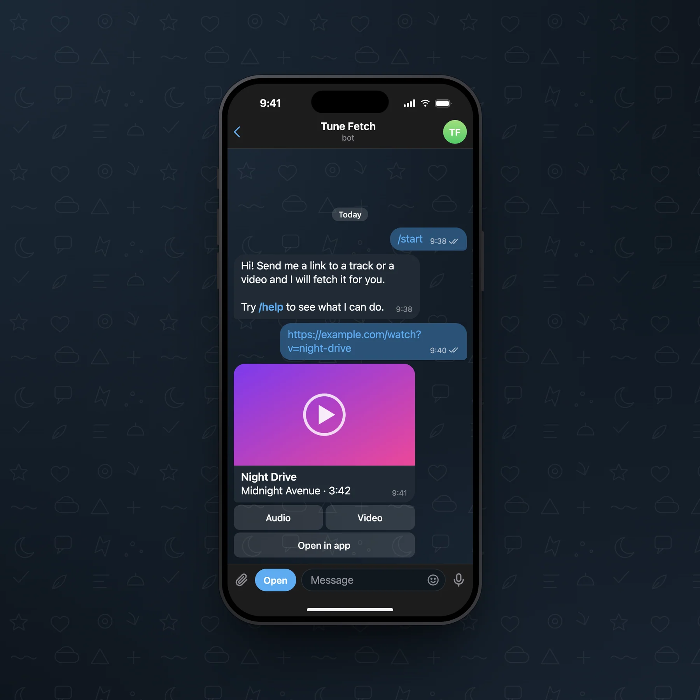 | 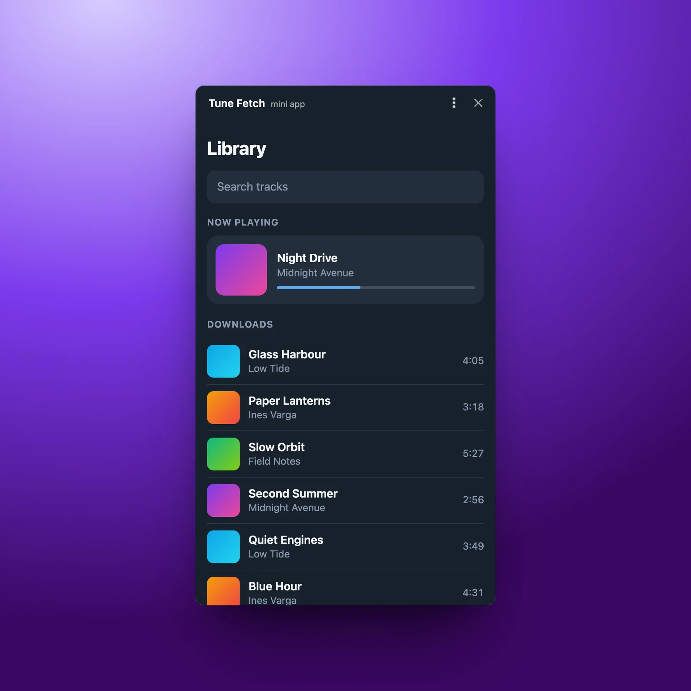 |

### Presets

| Preset               | Ratio  | Output                                                |
| -------------------- | ------ | ----------------------------------------------------- |
| `x`                  | 16:9   | native, at least 1600×900                             |
| `instagram-portrait` | 4:5    | native, at least 1080×1350                            |
| `instagram-square`   | 1:1    | native, at least 1080×1080                            |
| `og`                 | 1.91:1 | exactly 1200×630 (`--width native` for the full size) |

The canvas grows to the preset's ratio around the frame; the frame is never
squeezed.

### Resolution

The page is captured and the canvas is rendered at the same device pixel ratio
(2 by default), so every captured pixel lands on exactly one output pixel and
text stays crisp. A 1440 px desktop page gives a 2880 px wide window; with the
default padding an `x` shot is 4238×2384. Use `--width` for a lighter file and
`.webp` for a much smaller one. Output is never upscaled, and never smaller
than the preset needs.

### Canvases

`--canvas` takes any of:

- a Telegram wallpaper: `telegram-light`, `telegram-dark`, `telegram-blue`,
  `telegram-rose`, `telegram-violet`, `telegram-amber`
- a built-in: `accent`, `sun`, `ocean`, `violet`, `mint`, `rose`, `dark`, `soft`
  (glows), `paper`, `ink` (solid), `none` (transparent)
- one colour, for a solid canvas: `--canvas "#0ea5e9"`
- two or three colours, for a glow from the top left (light, main, deep):
  `--canvas "#fde68a,#f59e0b,#7c2d12"`
- a whole CSS gradient: `--canvas "linear-gradient(135deg, #111, #444)"`
- a name from your config file

With `--canvas none` the image is transparent. The frame keeps at least 200 px
of room so its shadow fades out fully; put it on any background you like.

### Per-project brand colours

Put a `shots.config.json` in a project (it is found from the working directory
upwards). `~/.config/shots/config.json` has the same shape and applies
everywhere; the project file wins.

```json
{
  "canvases": {
    "brand": ["#fff0a6", "#e9c60b", "#a38700"],
    "night": "#0b1020"
  },
  "defaults": {
    "canvas": "brand",
    "bar": "salonsvitlo.com.ua",
    "preset": "x"
  }
}
```

`defaults` accepts any option from the table above. Then `shot localhost:3000
--out hero.png` in that project comes out on the brand canvas.

## MCP server

`bin/mcp.js` is a stdio MCP server with two tools:

- **`frame_screenshot`**: the CLI's options as arguments (`sources`, `out`,
  `devices`, `frames`, `preset`, `canvas`, `tilt`, `shadow`, `bar`, `title`,
  `button`, `wallpaper`, …). A source may also be a conversation object, so an
  agent can render a Telegram chat without writing a file first. Writes the
  image and returns its path and size as JSON, plus a small preview the agent
  can look at.
- **`list_presets`**: presets, canvases (including the project's config),
  frames, wallpapers, devices and shadow strengths.

Add it to Claude Code for every project:

```bash
claude mcp add --scope user shots -- node ~/GitHub/exx0dusss/shots/bin/mcp.js
```

Or for one project, in its `.mcp.json`:

```json
{
  "mcpServers": {
    "shots": {
      "command": "node",
      "args": ["/Users/you/GitHub/exx0dusss/shots/bin/mcp.js"]
    }
  }
}
```

Claude Code starts the server in the project folder, so relative `out` paths
and the project's `shots.config.json` resolve there; pass `cwd` to point
at a folder inside it. Then ask for it in plain words: "frame localhost:3000 on a
phone for Instagram, brand canvas, save to marketing/hero.webp".

### Security

In the MCP server an agent picks the paths and URLs, and an agent can be
misled by text it reads on a page. So the server is limited in ways the CLI,
which you type yourself, is not:

- **Files stay in one directory.** `out`, `cwd`, image and conversation
  `sources`, a conversation's pictures and the `avatar` must lie
  under the directory the server was started in (Claude Code starts it in the
  project). Symlinks are resolved first, so a link that leads out does not
  pass. `SHOTS_ROOT=/some/dir` sets another directory; `SHOTS_ALLOW_OUTSIDE=1`
  lifts the limit.
- **Only images are written,** as `.png`, `.webp` or `.jpg`. An existing image
  at `out` is overwritten, as you would expect when re-shooting.
- **Only `http` and `https` are opened,** never `file:`. Link-local addresses
  and cloud metadata hosts (`169.254.0.0/16`, `fe80::/10`,
  `metadata.google.internal`) are refused, for the page itself and for
  anything it redirects to or loads. Host names are resolved first, so a
  public name pointed at such an address is refused too, and service workers
  are off.
- **`localhost` and private network addresses are allowed on purpose:**
  shooting your dev server is what the tool is for. It follows that the server
  can screenshot anything your machine can reach, such as a router page or an
  internal dashboard, and save it as an image in the project. Do not run it on
  a machine where that is a problem. The name check and the browser resolve a
  name separately, so each response's real server address is watched as well:
  the moment one is a blocked address the page is closed and no picture is
  taken. That request has been sent by then; its content never reaches the
  image.

Set the variables where the server is registered, for example
`claude mcp add --scope user -e SHOTS_ROOT=$HOME/GitHub shots -- node …/bin/mcp.js`.

## As a library

```js
import { frameShot } from "shots";

const { out, width, height } = await frameShot({
  sources: ["https://example.com"],
  device: "phone",
  preset: "instagram-portrait",
  canvas: "ocean",
  out: "ig.webp",
});
```

Pass `{ browser }` (from `launchBrowser()`) as the second argument to reuse one
Chrome across many shots.

## How it works

Each source is captured (or read), drawn inside its device as HTML and CSS, and
all devices are laid out on one page that Chrome screenshots once. Because a
frame is never rendered on its own and cropped, its shadow can only end at the
canvas edge and always fades out softly.

| File                | Does                                                  |
| ------------------- | ----------------------------------------------------- |
| `src/index.js`      | `frameShot`: options, the pipeline, encoding          |
| `src/capture.js`    | Capturing a URL, reading an image                     |
| `src/frames.js`     | The Safari window and the iPhone                      |
| `src/layout.js`     | Where frames sit, and the canvas size (pure geometry) |
| `src/presets.js`    | Presets, canvases, device metrics, shadows            |
| `src/config.js`     | `shots.config.json`                                   |
| `src/guard.js`      | The MCP server's file and host limits                 |
| `src/telegram.js`   | The Telegram Mini App and chat frames, conversations  |
| `src/wallpapers.js` | Telegram-style wallpapers                             |

`SHOTS_CHROME` picks another browser: a Playwright channel (`msedge`,
`chrome-beta`) or a path to a Chromium binary.

## Development

```bash
pnpm check     # eslint, prettier, tests
pnpm samples   # regenerate samples/ (pass another URL to shoot a different site)
```

## Limits

- Telegram frames follow the iOS app on the phone and Telegram Desktop on the
  desktop; there is no Android look. A conversation has text, pictures, inline
  keyboards and day separators: no replies, reactions, stickers or voice.
- Two desktops on one canvas are not supported; a pair is two phones, or a
  desktop with a phone.
- An image framed on a phone is fitted to the screen's width and cropped from
  the bottom; pass the page without the status bar.
- macOS fonts are used for the drawn Safari chrome, so on Linux it looks
  slightly different.
